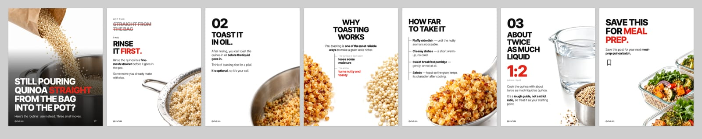
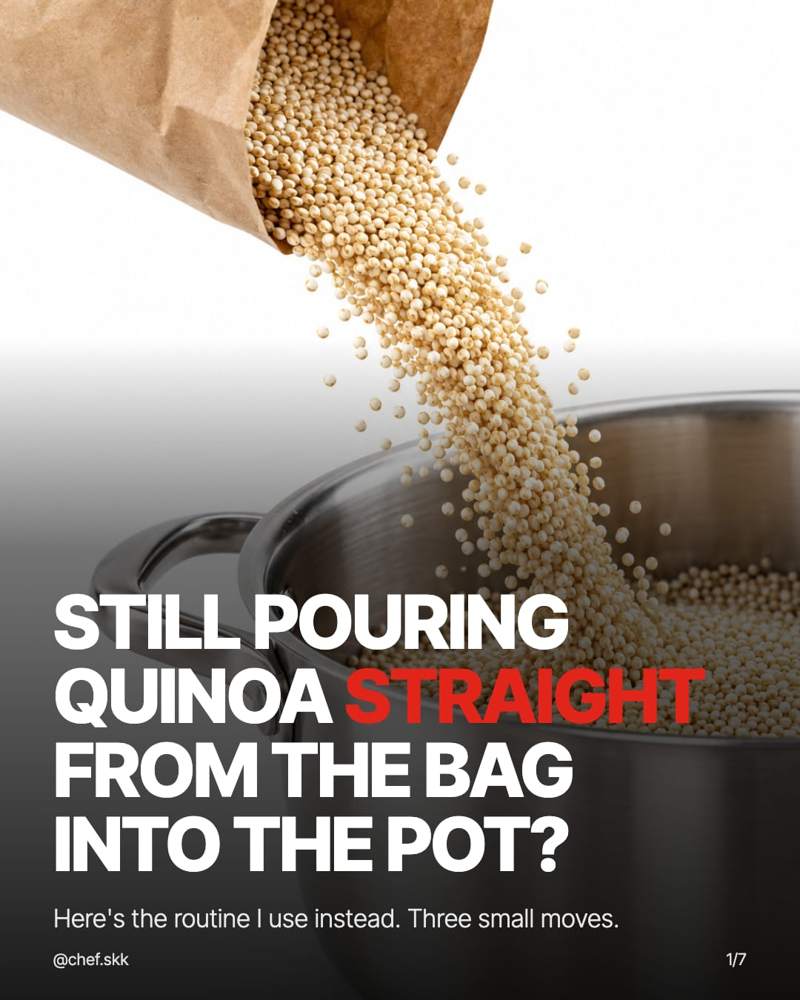
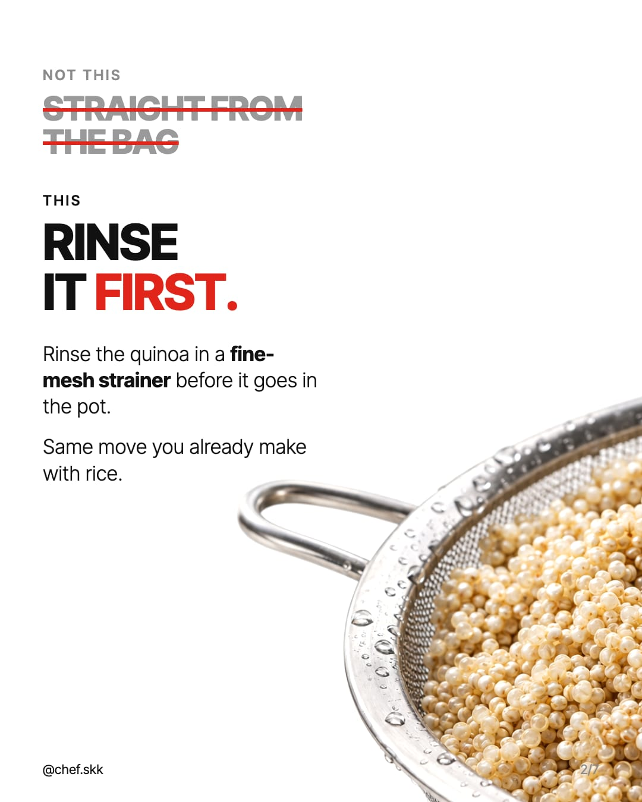
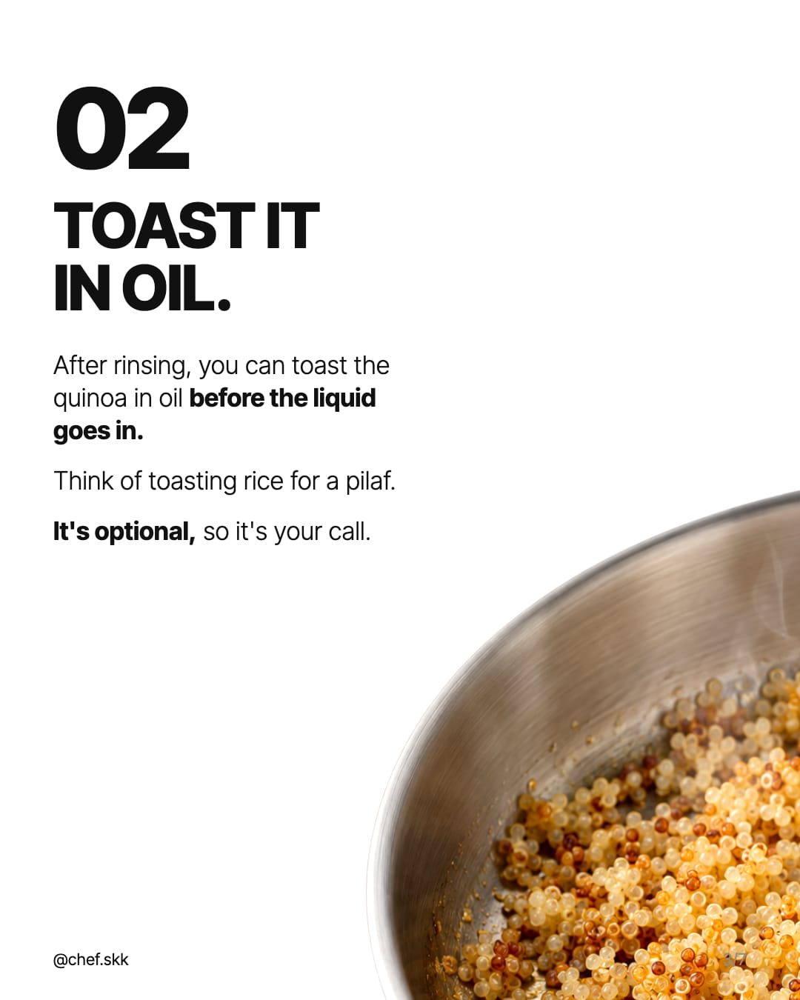
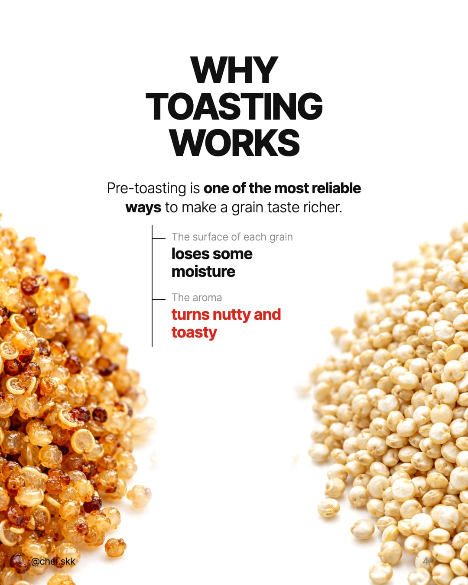
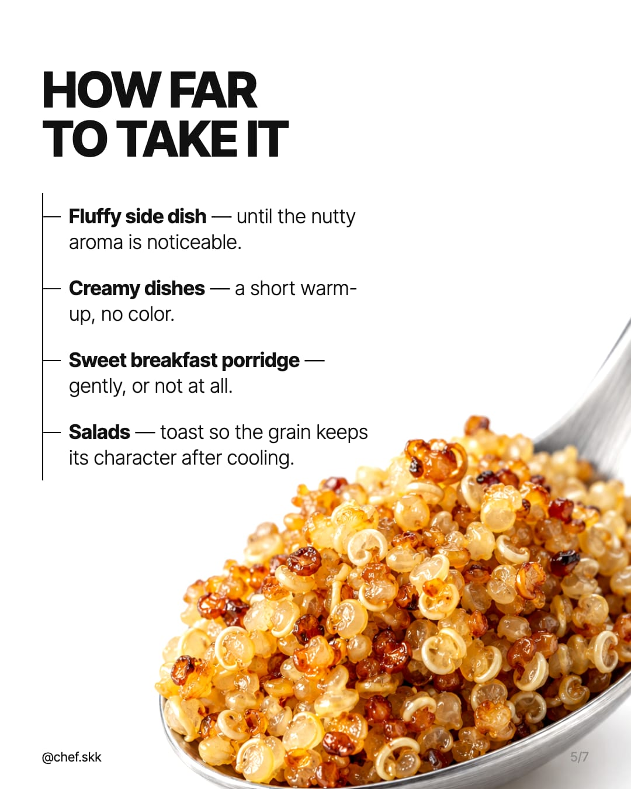
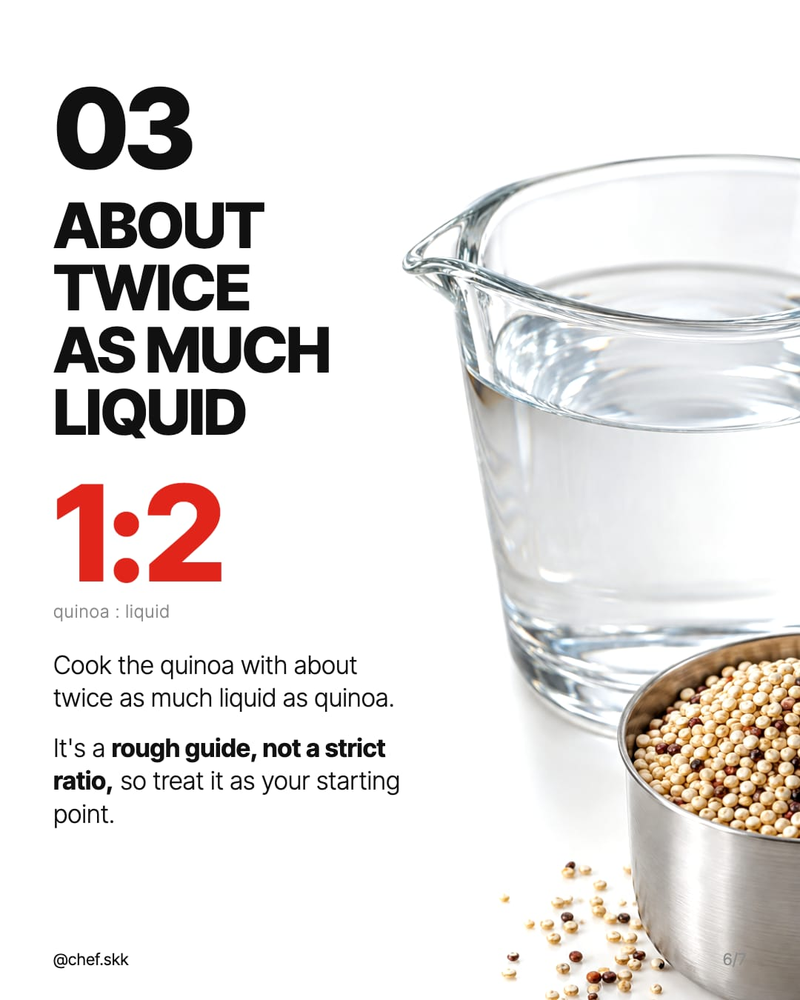
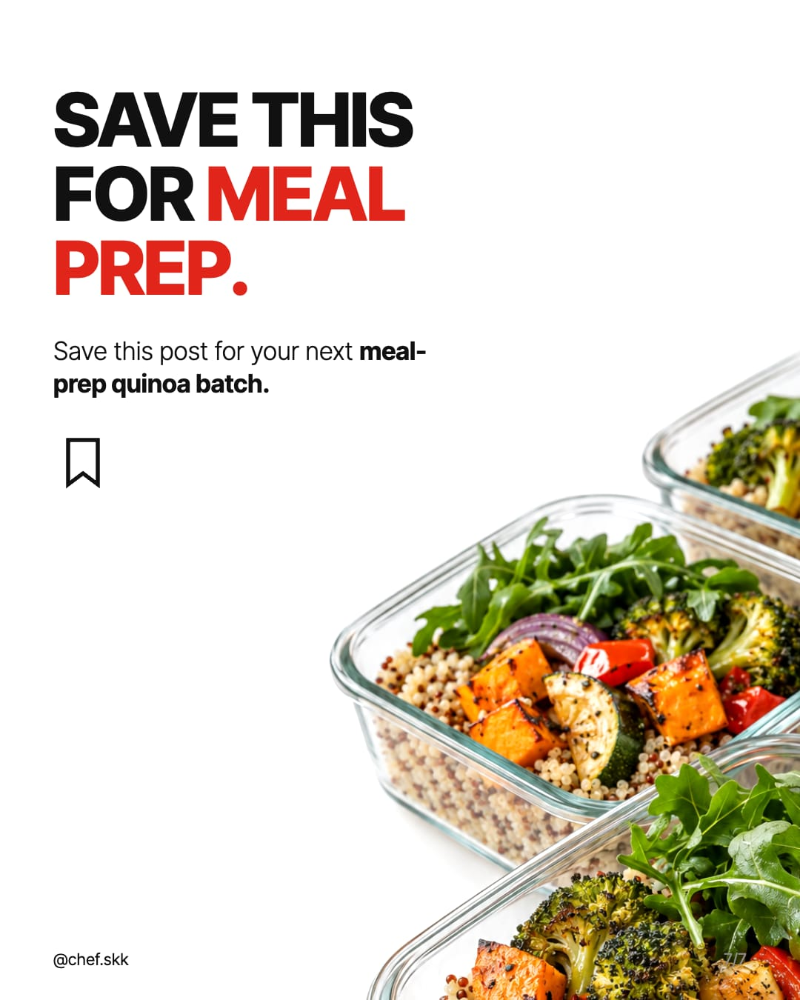

# Carousel visual style

**Status: ACCEPTED by the owner (2026-10-12).** Replaces the default look of plan 08 §8.3 (cream background, terracotta accent, Fraunces + Inter, small rounded photo in a corner), which read as generic AI output on the first live carousel.

The style was chosen on one test carousel (quinoa: rinse, toast, double liquid; English, 7 slides) in two rounds: three directions as static mock-ups, then the chosen direction with real generated photos. The reference was a Russian-language food account with large cut-out macro photography on white; it is an internal reference only and is not named in anything audience-facing.

## Principles

1. **White page, black type, one red.** No cream, no tinted panels, no card shadows, no filled blocks.
2. **Hierarchy by weight, not by colour or size.** Extra-bold uppercase headline, light body, two or three bold key phrases in the body.
3. **The photo is large and cut out on white.** A single macro subject takes 45–60 % of the slide and bleeds off the right and/or bottom edge. No frame, no rounded corners, no background of its own: the photo's white merges with the page.
4. **Text on one side only.** A text column of about 470 px (44 % of the width) on the left; the subject never sits under the text. The photo is attractive but never competes with the content.
5. **Air and thin lines.** Thin 2 px rules for diagrams (a tree from a thesis to its points), tiny footer, generous margins.

## Tokens

| Token | Value | Notes |
|---|---|---|
| `background` | `#FFFFFF` | page |
| `surface` | `#FFFFFF` | no panels |
| `text` | `#111111` | headline and body |
| muted | `#8C8C8C` | footer page number, small labels, struck-out mistake |
| `accent` | `#E1251B` | one or two words of a headline, a formula, the last branch of a diagram. Never a fill. |
| `negative` | `#E1251B` | strike-through line of a mistake |
| `positive` | `#111111` | the correct way is plain black |
| safe margin | 72 px | |
| text column | 470 px | from the left margin |

### Type

One family, **Inter Tight** (SIL OFL 1.1, variable `wght` 100–900, Latin + Latin Extended: covers `ñ ¿ ¡ á é í ó ú ü`). Bundled in `templates/assets/fonts/inter-tight/`.

| Role | Weight | Size (1080 × 1350) | Line height | Tracking | Case |
|---|---|---|---|---|---|
| Headline | 800 | 84 px (cover and CTA 100 px), fit-text down to 56 px | 1.0 | −0.02 em | UPPERCASE |
| Step number (`02`, `03`) | 800 | 150 px | 0.82 | −0.04 em | — |
| Formula / fact (`1:2`) | 800, accent | 180 px | 0.9 | −0.03 em | — |
| Body | 300 | 34 px, fit-text down to 30 px | 1.3 | 0 | sentence |
| Bold phrase in body | 700 | same as body | | | sentence |
| Label / kicker | 600 | 24 px | 1 | +0.14 em | UPPERCASE |
| Diagram caption | 300, muted | 24 px | 1.2 | +0.02 em | sentence |
| Footer (handle, page) | 400 | 22 px | 1 | +0.02 em | — |

Emphasis comes from the text itself: the writer marks key phrases with `**…**`. In a body slot it renders bold (700); in a headline it renders in the accent colour. At most one marked phrase per headline and three per body.

## Layouts

All on the 1080 × 1350 canvas, footer at 44 px from the bottom: handle bottom-left (ink), page `n/N` bottom-right (muted).

| Slide | Template | Layout |
|---|---|---|
| Hook / cover | A | Full-bleed photo, gradient from transparent at 34 % to 90 % black at the bottom, white headline (100 px) and subline over it; the marked headline word in accent. |
| Mistake → correct | E | Mistake title struck through in accent (6 px line) on muted grey type, 56 px; the correct title 84 px black; the correct text as body; photo bleeding right and bottom. |
| Step / explanation / fact | B | Optional step number 150 px (digits only → ink; anything else such as `1:2` → accent), headline, body; photo bleeding right and bottom. |
| Points of a thesis | D | Headline, then the steps as a tree: a 2 px vertical rule with a 30 px tick per item; photo in the lower-right corner. No icon circles. |
| Before / after, two sides | C | The two pictures flank the slide: one cut by the left edge, one by the right edge, softly faded towards the centre; labels and caption centred between them. |
| CTA | F | Headline 100 px with the marked phrase in accent, body, keyword as accent uppercase text (no filled box), an outline bookmark icon; photo bleeding right and bottom. |

### Photo placement

Inner slides receive a 4:5 picture (1080 × 1350 after normalization, generated as 2:3 portrait). It is drawn as a layer behind the text with `mix-blend-mode: multiply`, so its white disappears into the page, shifted right and down so the subject bleeds off the edge. Accepted offsets from the test carousel: x +190…+330 px, y +10…+290 px, scale 1.0–1.04. The template owns the offset; the photo is never cropped to a box.

## Photography

### Shot list (visual-director@4)

The first live carousel with `visual-director@3` showed a pot of grain on almost every slide: each picture was planned on its own and "one subject, no extra objects" left a vessel as the safe choice. From v4 the director first plans the carousel as a **shot list**, the way the accepted test round was planned by hand, and reads the **recipe** of the idea's cards (steps with their tools, ingredients, usual mistakes):

| `shotType` | What it shows | Typical slide |
|---|---|---|
| `INGREDIENT_MACRO` | the ingredient itself, very close, no vessel | explanation, fact |
| `TECHNIQUE_IN_ACTION` | the step while it happens: water through a strainer, steam, falling grains | step, mistake/correct, cover |
| `COMPARISON` | two states split in one frame (raw / toasted) | why it works, mistake/correct |
| `TOOL_AND_INGREDIENT` | the step's tool with the ingredient: measuring cup, strainer, spoon | step with a ratio or a tool |
| `FINISHED_DISH` | the finished food, served or packed | cover, CTA |
| `IN_THE_VESSEL` | the food in its pot or pan | at most twice |

Checked in code (`modules/src/content/visual/validate.ts`, one repair): no two neighbouring slides with the same shot, at most two `IN_THE_VESSEL`, at least three kinds from four pictures on. One or two natural ingredients of the recipe may add colour; no tool or ingredient the slide and the recipe do not name.

The director writes only the **subject and the action**. The code (`modules/src/content/visual/photo-prompt.ts`) appends the composition of the template slot (cover / side / centred), the style sentence and the fixed negative list, so every picture of a carousel shares them word for word. The same path serves "Regenerate pictures" of one market.

### Colour and visible action (visual-director@5)

The first live run of v4 (an English carousel about rescuing grains that came out too wet) had a varied shot list on paper, but all seven pictures were white rice on white: the recipe had no colourful ingredient, props were forbidden, and several shots rested on steam, clear water or a starch film, which do not show on white. From v5:

- **Colour accent on at least half of the pictures**, named in `colorAccent` with `colorSource`: `RECIPE` (an ingredient, tool or result of the recipe or slide) on any picture, `SERVING` (a classic partner the recipe does not name: herbs, a lemon wedge, cherry tomatoes, a fried egg) only on the cover and FINISHED_DISH shots, so it never looks like a recipe step. Checked in code (one repair).
- **Pale food** (rice, quinoa, pasta, oats, dough) gets contrast: one vessel of a strong colour (black cast iron, a deep-coloured or dark ceramic bowl) or the colour accent. Steel and clear glass alone are not contrast.
- **A visible action or texture in every frame** (a spoon lifting a clump, a fork fluffing, grains falling, a golden crust, droplets); steam, clear water and starch film are never the point of a picture.
- **COMPARISON** gets its own composition from the code: one frame split down the middle into two equal halves.
- The footer handle and page number have a soft halo in the page colour, so they stay legible where a photo runs under them (templates 2.0.1).

### Prompt rules

- **One subject, large, macro.** Cropped by the frame on the right and the bottom edge, never centred with air around it.
- **Empty left side.** "The left 40 % of the frame, top to bottom, is completely empty pure white." The model tends to drift the subject left; placement in the template compensates, so the prompt must say it firmly.
- **Pure white seamless background (`#FFFFFF`)**, high-key soft diffused studio light, a gentle contact shadow, shallow depth of field, saturated natural colours, crisp texture. Same light and palette on every slide.
- Materials: brushed stainless steel, clear glass. No rustic wood, grey stone, linen, cutting boards, props.
- No text, hands or faces. A two-sided slide (template C) gets one centred subject per picture.
- Cover: full-bleed, the subject in the upper two thirds, the bottom third calm (the headline goes there).

Shared style sentence used in the accepted round:

> Macro studio food photograph isolated on a pure white seamless background (#FFFFFF). High-key soft diffused studio light, a gentle natural contact shadow under the object, shallow depth of field, saturated natural colors, crisp texture detail, appetizing premium cookbook look. Brushed stainless steel and clear glass only. No text.

Negative:

> text, letters, numbers, logo, watermark, label, printed packaging, gray stone surface, rustic wooden table, cutting board, linen, dark background, colored backdrop, clutter, props, hands, people, faces, harsh flash, distorted food, extra objects, frame, border, vignette

Cost of the accepted round: 7 images × `gpt-image-2.5-sunburst`, `high`, 1024 × 1536 = 0.295 USD (≈ 0.042 USD each, from `usage`).

## Accepted slides

| | | |
|---|---|---|
|  |  |  |
|  |  |  |
|  | | |

## Implementation plan

Three pull requests, in order; none goes to `main` without the owner's merge.

1. **`docs/carousel-style`**: this document and the example slides.
2. **`feat/carousel-style-templates`** (`@rc/templates`, visual goldens):
   - Inter Tight in `templates/assets/fonts/inter-tight/` (Latin + Latin Extended WOFF2, OFL), registered in `fonts.ts`; glyph check covers the Spanish set.
   - `DEFAULT_VISUAL_SYSTEM`: the tokens above, fonts `inter-tight` / `inter-tight`.
   - Shared CSS: display slots 800 uppercase, line height 1.0, −0.02 em; body 300; footer handle and page indicator.
   - `**…**` emphasis in slot text: bold in body slots, accent in display slots (escaped first, markers never reach the page).
   - Templates A–F rebuilt to the layouts above; their 1:1 / 8:5 image slots become 4:5 cut-out layers; every template version goes to 2.0.0 (part of the render input hash, so old renders stay as they were).
   - Goldens: `pnpm test:visual --update` on macOS; Linux goldens from the CI `visual-actual` artifact.
3. **`feat/content-emphasis-and-photo-brief`** (`@rc/prompts`, `@rc/modules`):
   - `visual-director@3`: the photography rules above (cut-out on white, subject cropped right/bottom, empty left 40 %, one centred subject for two-sided slides, cover composition) and the negative list.
   - `content-writer@4`: mark one phrase per headline and up to three per body with `**…**`.
   - Slot length validation counts characters without the markers; the glyph check ignores them.
   - QA: a warning when a generated inner picture is not on white (mean luminance of its left 40 % below a threshold), so a grey-background photo is caught before review.
   - `PIPELINE_VERSION` minor bump and the eval record, as for any prompt change.

Not changed: the `AI info` label for the English market, the image provider and model.
